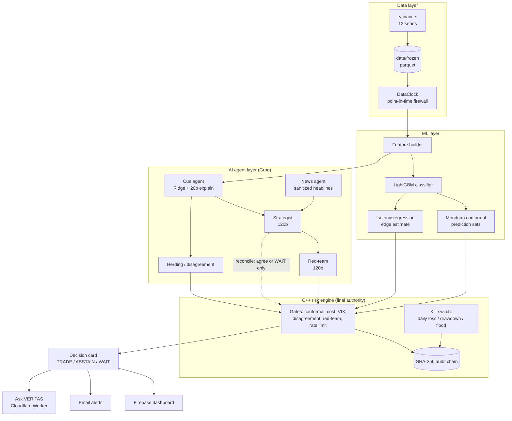
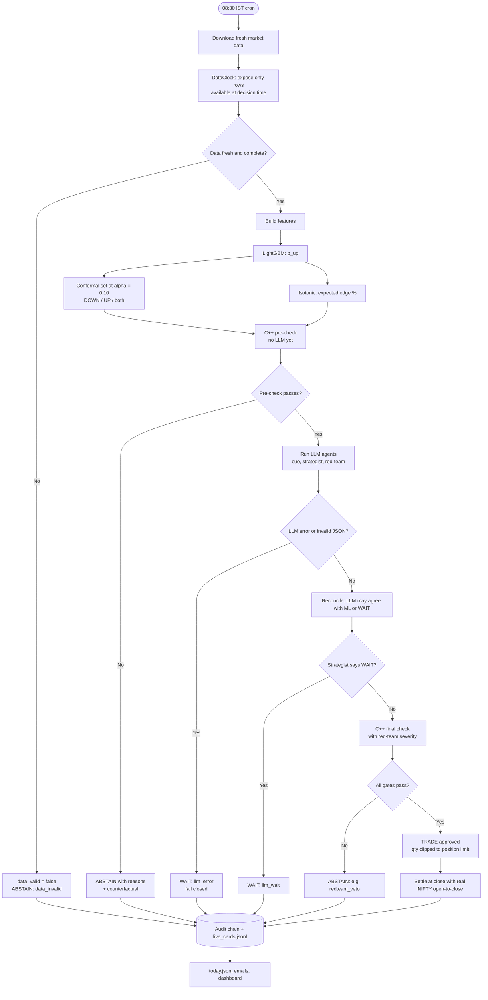
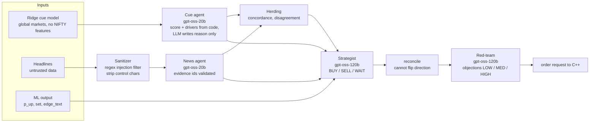
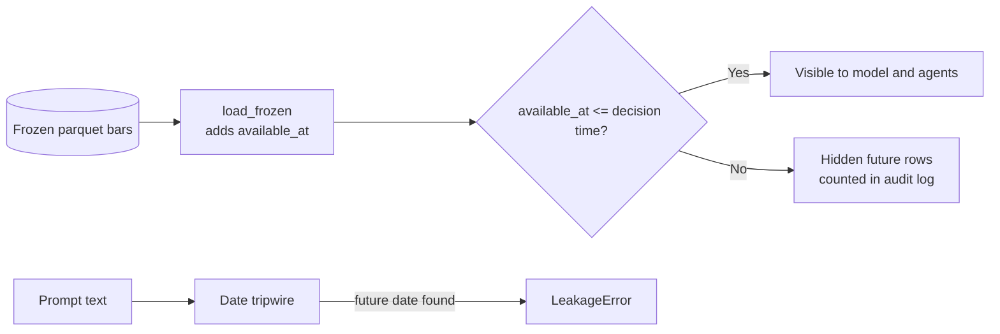
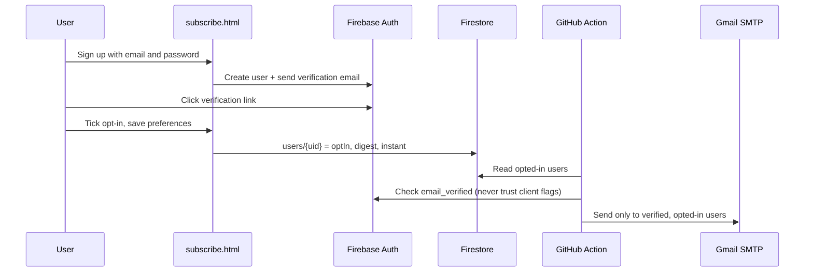

# VERITAS

**A paper-trading research system where machine learning proposes, AI agents review, and a deterministic C++ engine decides.**

VERITAS makes one decision per day for the Indian market (NIFTY, traded as a NIFTYBEES-style ETF proxy). Every morning at **08:30 IST** it answers one question: *trade, or abstain, and why?*

> **Paper trading only.** No real orders are placed. This is an educational research demo, not investment advice.

---

## Table of contents

1. [Core idea](#1-core-idea)
2. [System architecture](#2-system-architecture)
3. [Daily decision pipeline](#3-daily-decision-pipeline)
4. [The gates (C++ risk engine)](#4-the-gates-c-risk-engine)
5. [AI agent flow](#5-ai-agent-flow)
6. [Data and leakage protection (DataClock)](#6-data-and-leakage-protection-dataclock)
7. [ML + conformal prediction](#7-ml--conformal-prediction)
8. [Automation workflows (GitHub Actions)](#8-automation-workflows-github-actions)
9. [Alerts and subscriptions](#9-alerts-and-subscriptions)
10. [Web dashboard and Ask VERITAS chat](#10-web-dashboard-and-ask-veritas-chat)
11. [Tech stack](#11-tech-stack)
12. [Problems we hit and how we solved them](#12-problems-we-hit-and-how-we-solved-them)
13. [Results (honest)](#13-results-honest)
14. [Project structure](#14-project-structure)
15. [Setup and run](#15-setup-and-run)
16. [Testing](#16-testing)
17. [Configuration](#17-configuration)
18. [Limitations and roadmap](#18-limitations-and-roadmap)
19. [Disclaimer](#19-disclaimer)

---

## 1. Core idea

Most "AI trading bots" let an LLM decide and hope for the best. VERITAS inverts that:

| Layer | Role | Can it trade on its own? |
|---|---|---|
| **ML model** (LightGBM + conformal) | Proposes direction and an edge estimate | No, it only proposes |
| **LLM agents** (Groq, gpt-oss) | Explain, challenge, and may only *agree* or *WAIT* | **No**, they can never flip or originate a trade |
| **C++ risk engine** | Final authority: cost, uncertainty, risk, and kill-switch gates | **Yes, the only thing that can approve a trade** |

Design principles:

- **Abstaining is a feature.** The system is built to say "no trade" and explain why, with a counterfactual ("would TRADE if edge > 0.146%").
- **LLMs reason, code decides.** Numbers come from code. LLMs only write explanations and objections.
- **Fail closed.** Any AI error, bad JSON, stale data, or missing feature means no trade.
- **Everything is auditable.** Every decision lands in a SHA-256 hash-chained audit log.
- **No lookahead.** A point-in-time data firewall guarantees that the model never sees the future.

---

## 2. System architecture



---

## 3. Daily decision pipeline



**Key ordering rule:** ML plus gates run first. The LLM is only called on days that already pass, which saves API quota and means the LLM layer can only *remove* trades, never add them.

---

## 4. The gates (C++ risk engine)

`cpp/src/risk_engine.cpp` is a standalone process that speaks JSON-lines over stdin/stdout. Python spawns it via `risk_client.py`.

| Gate | Fails when | Why |
|---|---|---|
| `data_invalid` | Stale (over 6 days) or NaN features | Never decide on bad data |
| `conformal_ambiguous` | Prediction set contains both DOWN and UP | The model is not sure |
| `edge_below_cost` | Expected edge <= round-trip cost (about 0.146%) | Costs would eat the edge |
| `agent_disagreement` | Agents strongly disagree (above 0.6) | Herding/consensus check |
| `redteam_veto` | Red-team severity is HIGH | An independent reviewer objects |
| `vix_stress` | India VIX above 25 | Volatility too high |
| `rate_limit` | More than 5 orders per second | Order-flood protection, trips kill-switch |
| `kill_switch` | Daily loss at or above 2%, drawdown at or above 8%, manual kill, or flood | Hard stop |
| `invalid_size` | Quantity under 1 or price invalid | Sanity |

Extras:

- **Position clip:** never more than 2% of capital per trade.
- **Realistic costs:** brokerage, STT, exchange charges, SEBI fee, stamp duty, GST and slippage (`configs/costs.yaml`).
- **Counterfactuals:** "Would TRADE if expected edge > 0.146% (was -0.048%)".
- **Tamper-evident audit:** each log line has `hash = SHA256(prev_hash + entry)`. `risk_engine --verify <file>` returns `OK` or `BROKEN` with the line number.

---

## 5. AI agent flow



Safety rails around the LLMs:

- **Strict Pydantic schemas** (`schemas.py`). Out-of-range or invalid output is rejected, retried once, then fails closed.
- **Numbers from code.** The cue agent's score, confidence and drivers are overwritten with the computed values. Only the `reason` text comes from the LLM.
- **Prompt-injection defence.** Headlines are sanitized, flagged ones never reach the LLM, they are wrapped in `<data>` tags, and invented `evidence_ids` are dropped.
- **No direction flipping.** `reconcile()` converts any LLM direction that differs from the ML direction into WAIT.
- **Size cap.** `size_pct` is at most 2 by schema, and the C++ engine clips again.
- **Even a fully hijacked LLM is harmless.** `injection_demo.py` shows a max-size BUY demand being blocked by the C++ gate.

---

## 6. Data and leakage protection (DataClock)

Lookahead bias is the most common way trading backtests lie. VERITAS prevents it structurally.



Availability assumptions (deliberately conservative):

- **Indian series** (NIFTY, RELIANCE, TCS, HDFCBANK, INFY, INDIAVIX): available at **15:45 IST** on the bar date.
- **Everything else** (US, Japan, crude, gold, USDINR): available at **00:00 UTC on the next day**.
- Decision time: **03:00 UTC (08:30 IST)**.

Protections:

- `merge_asof(direction="backward")` joins features to the decision time.
- A tripwire asserts `avail_X <= decision_time` for every series.
- LLM prompts are scanned for dates after `as_of`, and a future date raises `LeakageError`.
- A test recomputes features from only what `DataClock` exposes and checks they equal the vectorised features.
- The live path is tested to reproduce the backtest cards exactly (before the LLM step).

---

## 7. ML + conformal prediction

**Target:** does NIFTY go up from open to close (`close/open - 1 > 0`)?

**Features:**
- NIFTY: 1/5/10-day returns, 10/20-day volatility, RSI14, MA20 ratio, daily range.
- India VIX: level and 1-day change.
- Global: 1-day returns of S&P 500, NASDAQ, Nikkei, Crude, Gold, USDINR.

**Split (chronological, no shuffling):**

```
|---- 60% train ----|---- 20% calibration ----|---- 20% test (held out) ----|
```

**Models:**

| Component | Method | Purpose |
|---|---|---|
| Classifier | LightGBM (small, regularised) | `p_up` |
| Uncertainty | Class-conditional (Mondrian) split conformal, alpha = 0.10 | Prediction sets. Two classes in the set means abstain |
| Edge | Isotonic regression of `|2p-1|` to signed return on calibration data | Expected edge in % to compare with costs |
| Cue | Ridge on non-NIFTY features | Interpretable global-market bias plus top drivers |

---

## 8. Automation workflows (GitHub Actions)

```mermaid
flowchart TB
    subgraph MORNING["morning-decision (03:00 UTC, Mon-Fri)"]
        M1[Checkout + Python + deps] --> M2[Build C++ engine]
        M2 --> M3[Fresh market data]
        M3 --> M4[python -m python.daily]
        M4 --> M5[Export candles]
        M5 --> M6[Send emails]
        M6 --> M7[Commit card + audit]
        M7 --> M8[Deploy Firebase Hosting]
    end

    subgraph EVENING["evening-recap (10:45 UTC, Mon-Fri)"]
        E1[Same setup] --> E2[Fresh data]
        E2 --> E3[python -m python.settle<br/>real open-to-close P&L]
        E3 --> E4[Recap emails]
        E4 --> E5[Commit + deploy]
    end

    subgraph WATCH["market-watch (every 30 min, 09:45-15:15 IST)"]
        W1[python -m python.watcher] --> W2[Save state and watch.json]
    end
```



- All three share the `veritas-live` concurrency group to prevent overlapping commits.
- Emails are **dry-run by default** on manual runs and only really sent on schedule or when `send=true`.
- Secrets: `GROQ_API_KEY`, `FIREBASE_SERVICE_ACCOUNT`, `GMAIL_USER`, `GMAIL_APP_PASSWORD`.

---

## 9. Alerts and subscriptions



Alert rules (`alerts/rules.py`, deterministic, no LLM):

| Event | Trigger | Level |
|---|---|---|
| `DAILY_DIGEST` | Every morning | info |
| `TRADE_APPROVED` | Decision is TRADE | alert |
| `REDTEAM_VETO` | Red-team gate failed | alert |
| `VIX_STRESS` | VIX gate failed | alert |
| `KILL_SWITCH` | Kill-switch, rate-limit or data-invalid failure | critical |
| `EVENING_RECAP` | After close | info |

Safety: idempotency keys (`email|date|kind`) prevent duplicate sends, HTML is escaped, every email carries a disclaimer, and Firestore rules limit each user to their own preferences doc (no email stored client-side).

---

## 10. Web dashboard and Ask VERITAS chat

- **Firebase Hosting** serves `web/`: today's card (`today.json`), full backtest data (`data.json`), candles (`candles.json`), and `subscribe.html`.
- **Cloudflare Worker** (`worker/index.js`) powers the "Ask VERITAS" chat:
  - Origin allow-list (CORS) plus per-IP rate limit (15 per minute).
  - Input caps (question 600 chars, context 12k chars, last 4 history turns).
  - Answers VERITAS questions only from the provided context and never invents numbers.
  - Refuses to give personal investment advice. Replies in English unless asked otherwise.
  - Groq `gpt-oss-120b` with low reasoning effort. The API key lives in a Worker secret.

---

## 11. Tech stack

| Area | Technology |
|---|---|
| Language | Python 3.14, C++17 |
| ML | LightGBM, scikit-learn (Ridge, Isotonic), NumPy, pandas, PyArrow |
| Uncertainty | Custom Mondrian split conformal prediction |
| LLM | Groq API: `openai/gpt-oss-20b` (fast), `openai/gpt-oss-120b` (strong), `llama-prompt-guard-2-86m` (configured guard) |
| LLM plumbing | Pydantic v2 schemas, tenacity retries, disk cache, replay mode |
| Risk engine | C++17, nlohmann/json, OpenSSL (SHA-256), CMake |
| Market data | yfinance (12 series, 5 years, daily) |
| Backend automation | GitHub Actions (cron plus manual dispatch) |
| Frontend | Static HTML/JS on Firebase Hosting |
| Auth and DB | Firebase Auth and Firestore (Spark plan, free) |
| Email | Gmail SMTP with app password |
| Edge API | Cloudflare Workers |
| Testing | pytest |

Design choices worth noting: a **separate-process C++ engine** keeps the final authority isolated from Python and LLM code. **Free-tier friendly** everywhere. **Config as YAML** (`models.yaml`, `limits.yaml`, `costs.yaml`).

---

## 12. Problems we hit and how we solved them

| # | Problem | Solution |
|---|---|---|
| 1 | **Lookahead leakage** can fake great backtests | `DataClock` with per-series `available_at`, backward as-of join, leakage tripwire assertions, a date tripwire for prompts, and tests proving vectorised features equal truncated-view features |
| 2 | **Models overtrade** and pay costs on weak signals | Conformal abstention plus a hard cost gate (`edge > round-trip cost`). Trade-every-day is kept as a baseline |
| 3 | **LLMs hallucinate numbers** | Scores and drivers are computed in code and overwritten. LLMs only write text. Strict schemas reject bad output |
| 4 | **Prompt injection via headlines** | Regex sanitizer, flagged items never reach the LLM, `<data>` wrapping, fake evidence IDs dropped, and a test with an injected "BUY 100%" headline |
| 5 | **A hijacked LLM could place a huge trade** | LLM cannot flip direction (`reconcile`), size is schema-capped, and the C++ engine independently clips and gates. `injection_demo.py` proves it |
| 6 | **Red-team false vetoes from unit confusion.** The cache shows it reading `size_pct 0.153` as "15.3%" against "0.153% edge" and vetoing | Introduced `edge_text` (a pre-formatted string the LLM must quote verbatim), a "never convert units" prompt rule, and `size_pct` defined as percent of capital. The prompt also states news is intentionally absent in price-only runs |
| 7 | **LLM API rate limits and cost** | 2.5 s throttle, exponential-backoff retries, content-addressed disk cache (SHA-256 of model, prompts and temperature), and LLM calls only on candidate days |
| 8 | **Reproducibility** of LLM-based runs | `LLM_MODE=replay` serves only from cache and raises `ReplayMiss` otherwise, and temperature is 0 |
| 9 | **LLM downtime or invalid JSON** | One retry with a corrective prompt, then `LLMError` is caught and the day becomes WAIT (fail closed) |
| 10 | **Silent log tampering** | Hash-chained audit log verified by a C++ `--verify` mode and a tamper-detection test |
| 11 | **Runaway behaviour or bugs** | Kill-switch on daily loss, drawdown, manual trigger, or order flood (more than 5 per second) |
| 12 | **Stale or missing live data** | Freshness check (more than 6 days stale or NaN features triggers `data_invalid`). The download script exits non-zero on any failure |
| 13 | **Live path diverging from backtest** | `live_artifacts.py` freezes the isotonic knots, cue model and calibration scores. A test checks live decisions match backtest cards |
| 14 | **Fake or unverified email subscribers** | Server reads the *verified* email from Firebase Auth (not a client flag). Firestore rules are locked to the user's own doc |
| 15 | **Email duplicates and abuse** | Idempotent `email|date|kind` keys, dry-run default, escaped HTML, disclaimers |
| 16 | **Public chat endpoint abuse** | Origin allow-list, per-IP rate limit, input size caps, server-side API key |
| 17 | **Concurrent workflow commits conflicting** | Shared concurrency group plus `git pull --rebase --autostash` before push |
| 18 | **Dashboard deploy permission failures** | Deploy step is non-fatal and prints exactly which IAM roles and APIs to enable |

---

## 13. Results (honest)

Held-out window: **2025-10-29 to 2026-10-23 (243 trading days)**, position value INR 20,000, round-trip cost about 0.146%.

| Strategy | Trades | Win rate | Gross P&L | Costs | **Net P&L** |
|---|---:|---:|---:|---:|---:|
| Trade every day | 243 | 40.3% | 1,528.93 | 7,055.74 | **-5,526.81** |
| ML + conformal + C++ gates | 57 | 45.6% | 552.78 | 1,655.27 | **-1,102.49** |
| **Full pipeline (with AI agents)** | 27 | 48.1% | 95.63 | 784.01 | **-688.38** |
| Buy and hold NIFTY | 1 | n/a | -2,603.34 | 0 | **-2,603.34** |

What this shows:

- **Abstention clearly reduces losses.** Gating cut the cost drag from INR 7,056 to INR 1,655, and the agent layer cut it further.
- **The red-team vetoed 23 of 50 candidates**, and every agent decision is stored for review.
- **There is no demonstrated profitable edge.** Gross P&L is tiny compared with costs. Costs dominate, and the system is honest about that.
- Only 94 of 243 days had an estimated edge above cost, and the median edge was negative.
- The agents ran price-only, because no historical news exists for the backtest. The news agent is exercised in live mode and in tests.
- These are in-sample-to-out-of-sample results on one window, not a performance guarantee.

---

## 14. Project structure

```
VERITAS/
├── cpp/                      C++ risk engine (final authority)
│   ├── src/risk_engine.cpp   gates, costs, kill-switch, audit chain
│   ├── src/hello.cpp         build smoke test
│   └── CMakeLists.txt
├── python/
│   ├── dataclock.py          point-in-time data firewall
│   ├── ml/                   features, LightGBM training, conformal
│   ├── agents/core.py        cue, news, strategist, red-team, herding
│   ├── llm.py                Groq wrapper: cache, replay, throttle, validation
│   ├── schemas.py            strict Pydantic output schemas
│   ├── orchestrator.py       agent outputs to C++ order request, reconcile
│   ├── risk_client.py        Python to C++ JSON-lines bridge
│   ├── pipeline.py           full backtest with agents
│   ├── daily.py              live single-day decision
│   ├── settle.py             evening settlement with real close
│   ├── live_artifacts.py     freeze models for the live path
│   ├── export_web.py         results to web/data/data.json
│   ├── export_candles.py     NIFTY candles for the chart
│   ├── download_data.py      yfinance downloader (fails loudly)
│   ├── injection_demo.py     prompt-injection demonstration
│   ├── alerts/               rules, render, mailer, subscribers, runner
│   └── tests/                pytest suite
├── configs/                  models.yaml, limits.yaml, costs.yaml
├── data/                     frozen parquet, models, LLM cache, live cards/audit
├── results/                  backtest and pipeline summaries and cards
├── web/                      dashboard, subscribe page, data JSON
├── worker/                   Cloudflare Worker (Ask VERITAS)
├── .github/workflows/        morning, evening, watch
├── firebase.json, firestore.rules
├── scripts/setup.sh
└── requirements.txt
```

---

## 15. Setup and run

```bash
# 1. One-shot setup (apt packages, venv, deps, C++ build)
bash scripts/setup.sh
source .venv/bin/activate

# 2. Secrets
export GROQ_API_KEY=...            # required for live LLM calls

# 3. Data and models
python python/download_data.py
python -m python.ml.train_technical
python -m python.live_artifacts

# 4. Backtest and full agent pipeline
python -m python.pipeline                      # add --max-llm-days 5 for a cheap trial
LLM_MODE=replay python -m python.pipeline      # reproducible run from cache only

# 5. Live decision for today (IST)
python -m python.daily                         # --no-llm to skip agents, --no-save for dry run
python -m python.settle                        # after the close

# 6. Dashboard data
python -m python.export_web
python -m python.export_candles

# 7. Alerts (dry-run by default, writes HTML to outbox/)
python -m python.alerts.run_alerts --cards data/live_cards.jsonl --phase morning
python -m python.alerts.run_alerts --send --live    # really send

# 8. Verify any audit log
./cpp/build/risk_engine --verify data/live_audit/2026-10-26.jsonl

# 9. Prompt-injection demo
python -m python.injection_demo
```

Deploy:

```bash
firebase deploy --only hosting,firestore:rules
cd worker && npx wrangler secret put GROQ_API_KEY && npx wrangler deploy
```

---

## 16. Testing

```bash
pytest -q
```

| Suite | What it proves |
|---|---|
| `test_dataclock` | No future rows visible, leakage tripwire works |
| `test_ml` | No dataset leakage, features match truncated views, conformal coverage holds |
| `test_risk_engine` | Every gate, clipping, kill-switch, audit tamper detection |
| `test_llm` | Cache, fenced JSON, retries, replay mode, date tripwire |
| `test_agents` | Injection blocked, fake evidence dropped, schema rejects oversized proposals, C++ stops a hijacked LLM |
| `test_pipeline` | LLM can only remove trades, fails closed, cannot flip direction |
| `test_backtest` | Full accounting, P&L identity, determinism, audit chain |
| `test_live` | Live path reproduces backtest cards |
| `test_alerts` / `test_export_web` | Alert rules, HTML escaping, data contract |

C++-dependent tests skip automatically if the engine is not built.

---

## 17. Configuration

| File | Controls |
|---|---|
| `configs/models.yaml` | Which Groq models serve `fast`, `strong` and `guard` roles |
| `configs/limits.yaml` | Max position 2%, daily loss 2%, drawdown 8%, 5 orders/sec, starting capital INR 1,000,000 |
| `configs/costs.yaml` | Brokerage, STT, exchange, SEBI, stamp, GST, slippage. **Verify against your broker's current charges** |

Optional limit keys read by the engine with defaults: `max_disagreement` (0.6), `vix_abstain` (25), `edge_cost_multiple` (1.0).

---

## 18. Limitations and roadmap

**Known limitations**
- Single instrument, daily frequency, open-to-close only.
- Price-only backtest. There is no archived historical news for the agent layer.
- Costs exceed the measured edge, so the system does not show profitability.
- yfinance data quality and the simplified `available_at` assumptions are approximations.
- One test window. More walk-forward folds would give stronger evidence.

**Roadmap**
- Walk-forward re-training and re-calibration.
- Archived news to evaluate the news agent historically.
- Multi-asset universe and portfolio-level risk.
- Prompt-guard model in the headline path (already configured in `models.yaml`).
- Slippage model calibrated from real intraday data.

---

## 19. Disclaimer

VERITAS is a **paper-trading research and education project**. It does not place real orders and nothing it produces is investment advice. Past or simulated results do not predict future performance. Trading involves risk of loss.
